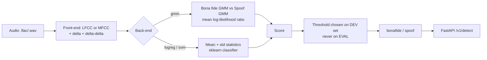
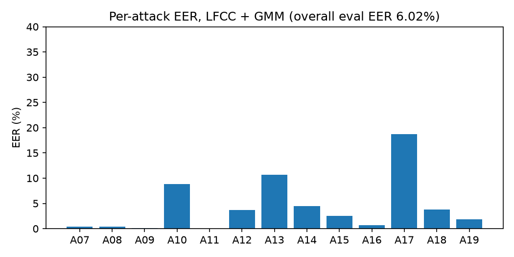
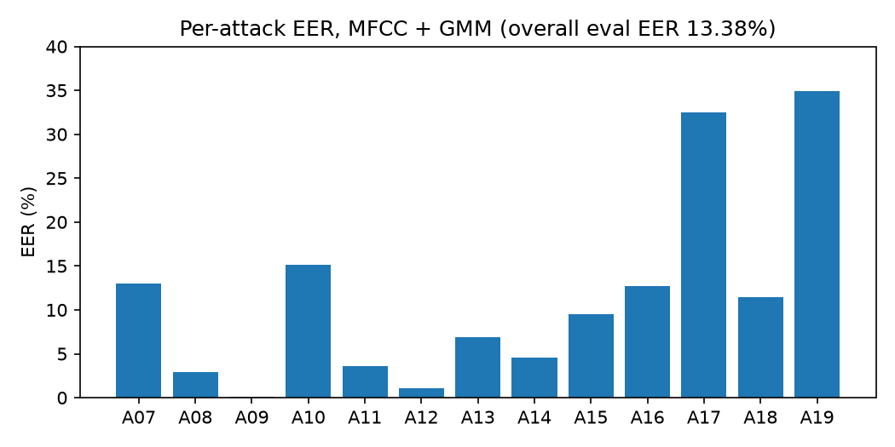

# voice-spoof-detector


Detect synthetic (text-to-speech / voice-conversion) and replayed speech.
Reproducible baselines, evaluation that reports **where the model fails** and not just a headline number,
and a small containerised API.

**Headline result:** an LFCC + GMM detector reaches **6.0% EER (AUC 0.985)** on the full ASVspoof 2019 LA
evaluation set (71,237 utterances), whose attacks are mostly absent from training. Error is concentrated
in a few unseen attacks (A17, A13, A10), and a threshold tuned on the development set lets 26% of spoofs
through. Details and caveats are below.

> **Status:** v0.1 classical baselines. GMM back-ends are benchmarked on the full ASVspoof 2019 LA set.
> Logistic-regression and SVM back-ends are implemented and unit-tested but not yet benchmarked at full scale.
> A neural model (wav2vec2) and a cross-dataset test are the next milestones, see [docs/ROADMAP.md](docs/ROADMAP.md).

## Why this project

Voice cloning has made phone-based fraud cheap, so voice channels (banking, call centres, KYC) need an
anti-spoofing layer. This repo is a clean-room, public-data implementation of that idea. The emphasis is on
honest evaluation: spoofing detectors routinely look excellent on attacks they were trained on and degrade on
unseen ones, so every report here includes **per-attack EER on attacks absent from training**.

## Architecture



Score convention everywhere: **higher = more likely bona fide**.

## Results

ASVspoof 2019 Logical Access, **full evaluation split** (7,355 bona fide, 63,882 spoofed utterances; attacks
A07-A19, of which only A16 and A19 reuse algorithms seen in training). Models are trained on the 25,380-utterance
`train` split. The decision threshold is chosen on a 3,000-utterance sample of `dev`, and `eval` is scored once.

| Front-end | Back-end | Eval EER | Eval AUC | Real speech rejected @ dev threshold | Spoofs accepted @ dev threshold | Hardest attacks (EER) |
|-----------|----------|---------:|---------:|-------------------------------------:|--------------------------------:|-----------------------|
| LFCC | GMM (64) | **6.02%** | 0.985 | 0.18% | 26.3% | A17 (18.7%), A13 (10.7%), A10 (8.8%) |
| MFCC | GMM (64) | 13.38% | 0.934 | 7.93% | 17.7% | A19 (34.9%), A17 (32.5%), A10 (15.2%) |

Per-attack EER (%, bona fide vs a single attack):

| Attack | A07 | A08 | A09 | A10 | A11 | A12 | A13 | A14 | A15 | A16 | A17 | A18 | A19 |
|--------|----:|----:|----:|----:|----:|----:|----:|----:|----:|----:|----:|----:|----:|
| LFCC + GMM | 0.40 | 0.35 | 0.10 | 8.79 | 0.03 | 3.69 | 10.71 | 4.48 | 2.54 | 0.69 | 18.74 | 3.83 | 1.81 |
| MFCC + GMM | 12.98 | 2.91 | 0.07 | 15.17 | 3.57 | 1.08 | 6.88 | 4.52 | 9.53 | 12.72 | 32.47 | 11.48 | 34.88 |

| LFCC + GMM | MFCC + GMM |
|:----------:|:----------:|
|  |  |

The charts were redrawn from the recorded evaluation output, and all numbers are in
[`docs/results/RESULTS.md`](docs/results/RESULTS.md). ROC curves and raw score files from these runs were not
retained and will be added when the runs are repeated.

### What the results show

**LFCC beats MFCC overall, but not on every attack.** LFCC cuts eval EER from 13.4% to 6.0%. Most of the gap comes
from A07, A16, A18 and A19; the largest is A19 (1.8% vs 34.9%). MFCC is better on A12 and A13, so the front-end
choice is not uniformly better. One plausible reason for the overall gap is that LFCC keeps full resolution in the
high band, where vocoder artefacts tend to appear, while the mel scale compresses it. I have not tested this; a
sub-band ablation would be the way to check.

**The hardest attacks are the ones that build output differently from the training attacks.** For the best model the
hardest attacks are A17 (18.7%), A13 (10.7%) and A10 (8.8%). According to the ASVspoof 2019 database papers, A17 is a
voice-conversion system with a VAE acoustic model and waveform filtering, A13 is a hybrid TTS-to-VC system that
uses spectral filtering, and A10 is Tacotron 2 with a WaveRNN neural vocoder. A hypothesis: A17 and A13 produce
their output by filtering a source waveform rather than synthesising one with a vocoder, so they may keep more of
the natural signal's short-term spectral structure, while A10's neural vocoder is higher fidelity than the older
vocoders in the training attacks. This is consistent with the original challenge analysis, where A13, A14 and A17
remained difficult even for the better of the two official GMM baselines. It is a hypothesis and not a tested claim.

**A threshold tuned on known attacks is too lenient for unseen ones.** At the dev-chosen threshold the LFCC + GMM
system rejects only 0.18% of real speech but accepts 26.3% of spoofs, because dev contains only the six training
attacks. The EER-optimal threshold on eval (1.51) is about double the dev threshold (0.75). In deployment, the
operating point should be calibrated on a held-out set of different attack families, not on data from the training attacks.

**Comparison with the official baseline.** The ASVspoof 2019 organisers report 8.09% eval EER for their LFCC-GMM
baseline (B02) using 512-component GMMs. This implementation reaches 6.02% with 64 components, a random 60-frame
subsample per training utterance, and 8-second truncation. This should **not** be read as beating the baseline:
feature extraction details, training setup, and the EER computation (here taken from the ROC curve, not the
challenge's scoring script) all differ.

### Caveats

* One training run per configuration, seed 0, no confidence intervals. Raw scores from these runs were not kept, so the numbers cannot be re-derived from files in this repo until the runs are repeated.
* The MFCC GMM fit hit the 100-iteration EM limit without converging (scikit-learn warning); LFCC was not
  checked for this.
* Per-attack EERs for A07-A19 each come from about 4,900 spoofed utterances plus all 7,355 bona fide ones.
* Trained and tested on read English speech from one corpus (VCTK-derived); no cross-dataset or telephony test yet.

## Reproduce

```bat
:: Windows (use .venv/bin/activate on Linux/macOS)
python -m venv .venv
.venv\Scripts\activate
pip install -r requirements-dev.txt
pip install -e .
python -m pytest -q

python -m vsd.train --data-root data\LA --features lfcc --backend gmm --out models\lfcc_gmm.joblib
python -m vsd.evaluate --model models\lfcc_gmm.joblib --data-root data\LA --split eval --out-dir results\lfcc_gmm
python -m vsd.train --data-root data\LA --features mfcc --backend gmm --out models\mfcc_gmm.joblib
python -m vsd.evaluate --model models\mfcc_gmm.joblib --data-root data\LA --split eval --out-dir results\mfcc_gmm
```

Dataset setup: [docs/DATASETS.md](docs/DATASETS.md). Settings behind the results: 20 coefficients + deltas (60 dims),
25 ms window, 10 ms hop, 64-component diagonal-covariance GMMs, seed 0. The full GMM fit is slow on a CPU
(the MFCC fit took about 80 minutes on my laptop); `--max-train-utts` and `--n-components` trade accuracy for speed.
The `Makefile` has equivalent shortcuts for Linux/macOS.

### Call the API

```bash
VSD_MODEL_PATH=models/lfcc_gmm.joblib uvicorn vsd.api:app --port 8000
curl -F "file=@sample.wav" http://localhost:8000/v1/detect
# {"label":"spoof","score":-3.1,"threshold":0.75,"duration_s":3.2,"model":{...}}
```

### Docker

```bash
docker build -t voice-spoof-detector .
docker run -p 8000:8000 -v $(pwd)/models:/models voice-spoof-detector
```

## Protocol

* Train on `train`, choose the decision threshold on `dev`, report on `eval` once.
* ASVspoof 2019 LA `eval` contains attacks (A07-A19) that are mostly **not** in `train` (A01-A06), so it measures
  generalisation to unseen attack types. A16 and A19 reuse the algorithms of A04 and A06 with different data.
* Fixed seeds; model metadata (features, backend, dev EER) is stored inside the model file.

## Repository layout

```
src/vsd/features.py   LFCC / MFCC front-ends
src/vsd/detector.py   GMM, logreg, SVM back-ends behind one interface
src/vsd/data.py       ASVspoof 2019 LA + generic CSV manifest loaders
src/vsd/metrics.py    EER, AUC, per-attack EER
src/vsd/train.py      training CLI          src/vsd/evaluate.py  evaluation CLI
src/vsd/api.py        FastAPI service       src/vsd/synthetic.py  tiny corpus for tests/CI only
docs/results/         metrics and plots for the runs above
```

## Limitations and responsible use

* Accuracy on phone-band, noisy or compressed audio will likely be lower, and unseen generators may evade it.
* Not a standalone fraud-prevention control. Use it as one signal alongside other checks, with human review
  for consequential decisions. See [MODEL_CARD.md](MODEL_CARD.md).
* The synthetic corpus in `src/vsd/synthetic.py` is not speech; it exists only so CI can run offline.

## References

* Wang et al., *ASVspoof 2019: A large-scale public database of synthesized, converted and replayed speech*, 2020.
* Todisco et al., *ASVspoof 2019: Future Horizons in Spoofed and Fake Audio Detection*, Interspeech 2019.

## License

MIT for the code. The ASVspoof 2019 dataset has its own license; it is not redistributed here.
