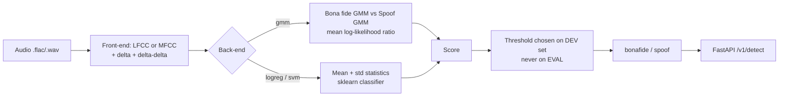

# voice-spoof-detector


Detect synthetic (text-to-speech / voice-conversion) and replayed speech.
Reproducible baselines, evaluation that reports **where the model fails** and not just a headline number,
and a small containerised API.

> **Status:** v0.1 baselines (LFCC/MFCC + GMM / logistic regression / SVM). A neural model (wav2vec2 fine-tune)
> is the next milestone, see [docs/ROADMAP.md](docs/ROADMAP.md).

## Why this project

Voice cloning has made phone-based fraud cheap, so voice channels (banking, call centres, KYC) need an
anti-spoofing layer. This repo is a clean-room, public-data implementation of that idea. The emphasis is on
honest evaluation: spoofing detectors routinely look excellent on attacks they were trained on and collapse on
unseen ones, so every report here includes **per-attack EER on attacks absent from training**.

## Architecture



Score convention everywhere: **higher = more likely bona fide**.

## Quick start

```bash
git clone https://github.com/meeka55/voice-spoof-detector && cd voice-spoof-detector
python -m venv .venv && source .venv/bin/activate
make install            # pip install -r requirements-dev.txt && pip install -e .
make test               # 20 tests, uses a tiny synthetic corpus; no download needed
```

### Train and evaluate on real data

1. Download ASVspoof 2019 LA (see [docs/DATASETS.md](docs/DATASETS.md)) and unpack it to `data/LA`.
2. Run:

```bash
make train DATA=data/LA        # LFCC + GMM baseline  -> models/lfcc_gmm.joblib
make eval  DATA=data/LA        # eval split           -> results/lfcc_gmm/{metrics.json,roc.png,per_attack_eer.png,scores.csv}
make serve                     # API on http://localhost:8000/docs
```

Quick experiments: `python -m vsd.train --data-root data/LA --max-train-utts 3000 --backend logreg`.

### Call the API

```bash
curl -F "file=@sample.wav" http://localhost:8000/v1/detect
# {"label":"spoof","score":-3.1,"threshold":0.4,"duration_s":3.2,"model":{...}}
```

### Docker

```bash
docker build -t voice-spoof-detector .
docker run -p 8000:8000 -v $(pwd)/models:/models voice-spoof-detector
```

## Protocol (how results are produced)

* Train on `train`, choose the decision threshold on `dev`, report on `eval` once.
* ASVspoof 2019 LA `eval` contains attacks (A07-A19) that are **not** in `train` (A01-A06), so it measures
  generalisation to unseen attack types.
* Fixed seeds; model metadata (features, backend, dev EER) is stored inside the model file.

## Results

> Fill this table from **your own** `results/*/metrics.json`. Do not copy numbers from papers.

| Front-end | Back-end   | Dev EER | Eval EER | Eval AUC | Hardest attack (EER) |
|-----------|------------|---------|----------|----------|----------------------|
| LFCC      | GMM (64)   | _tbd_   | _tbd_    | _tbd_    | _tbd_                |
| MFCC      | GMM (64)   | _tbd_   | _tbd_    | _tbd_    | _tbd_                |
| LFCC      | LogReg     | _tbd_   | _tbd_    | _tbd_    | _tbd_                |
| LFCC      | SVM (RBF)  | _tbd_   | _tbd_    | _tbd_    | _tbd_                |

Add `results/<run>/roc.png` and `per_attack_eer.png` here once generated, and write 3-4 sentences on
*which attacks fail and why you think so*. That analysis is the valuable part.

## Repository layout

```
src/vsd/features.py   LFCC / MFCC front-ends
src/vsd/detector.py   GMM, logreg, SVM back-ends behind one interface
src/vsd/data.py       ASVspoof 2019 LA + generic CSV manifest loaders
src/vsd/metrics.py    EER, AUC, per-attack EER
src/vsd/train.py      training CLI          src/vsd/evaluate.py  evaluation CLI
src/vsd/api.py        FastAPI service       src/vsd/synthetic.py  tiny corpus for tests/CI only
```

## Limitations and responsible use

* Trained on read English speech recorded in clean conditions; accuracy on phone-band, noisy or
  compressed audio will be lower, and unseen generators may evade it.
* Not a standalone fraud-prevention control. Use it as one signal alongside other checks, with human review
  for consequential decisions. See [MODEL_CARD.md](MODEL_CARD.md).
* The synthetic corpus in `src/vsd/synthetic.py` is not speech; it exists only so CI can run offline.

## License

MIT for the code. Datasets have their own licenses; check them before redistributing anything.
